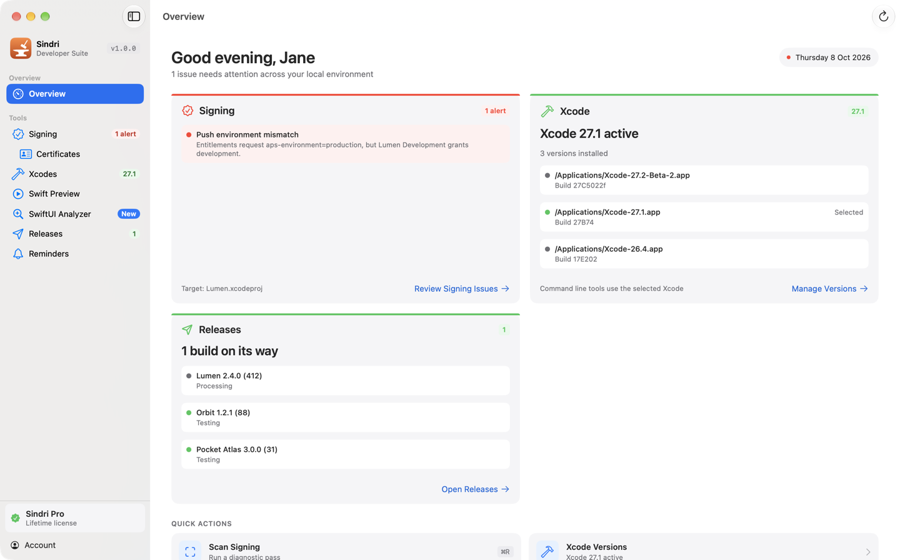
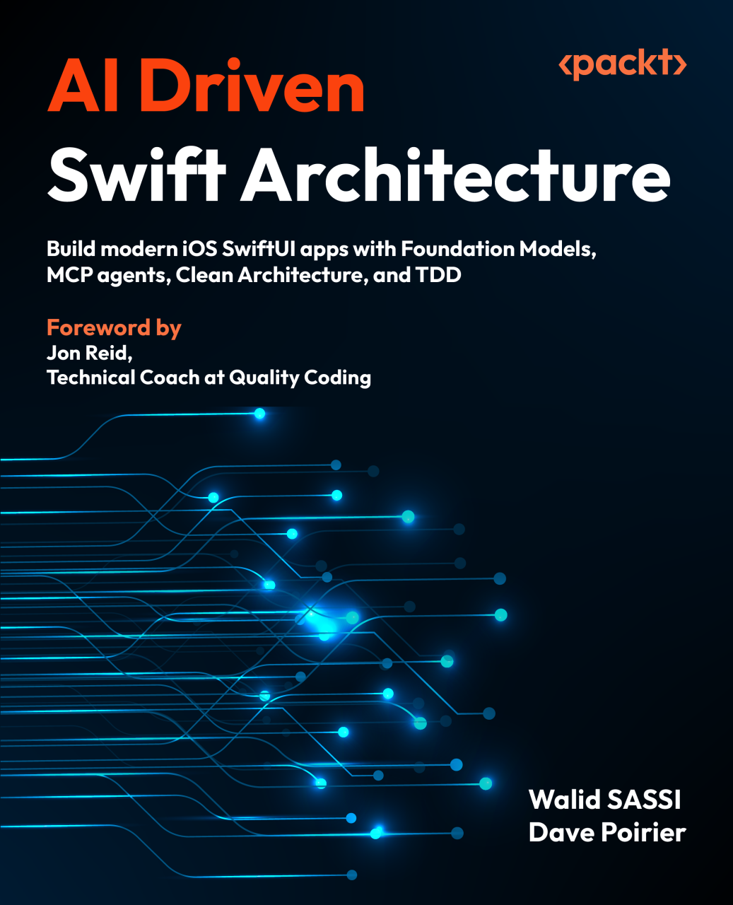

  <h1>Walid SASSI</h1>
  
iOS Tech Lead • Software Architecture • Distributed Systems

  

  <b>Sindri</b> 
  A native macOS app for Apple platform developers. 
  Find what’s wrong with your signing, Xcode installs and releases before the build does.

  <a href="https://getsindri.app"><b>getsindri.app</b></a> •
  <a href="https://github.com/sassiwalid/sindri-releases/releases/latest">Download for macOS</a>

  <a href="https://getsindri.app">
    <picture>
      <source media="(prefers-color-scheme: dark)" srcset="assets/sindri-overview-dark.png"/>
      
    </picture>
  </a>

  Signing and Certificates are free • macOS 15 or later • Apple silicon and Intel

---

  

  <b>AI-Driven Swift Architecture</b> 
  Designing scalable and modern iOS systems.

---

## About

iOS Tech Lead based in France 🇫🇷.  
I focus on building scalable, maintainable systems and improving developer experience.

---

## Focus

- Software Architecture  
- Distributed Systems  
- Developer Tooling  

---

## Content

- Swift Academy (Podcast)  
- Swift With Walid (YouTube)  

---

## Links

- https://getsindri.app  
- https://walidsassi.com  
- https://linkedin.com/in/sassi-walid  
- https://swifttribune.walidsassi.com  

---

  Building clean systems, one abstraction at a time.

